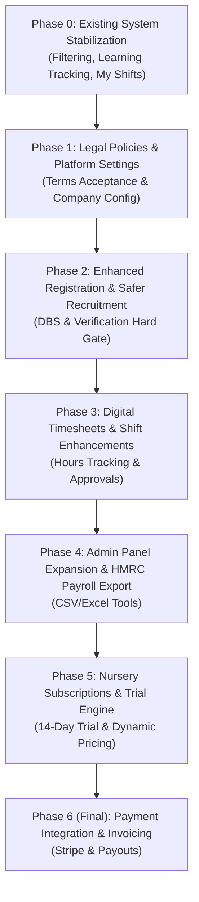

# KFlex (Bridge-Flex): Architecture Review, Gap Analysis & Phased Implementation Plan

> **Document Version:** 1.1  
> **Date:** October 2026  
> **Target Release:** Production Launch (App Store Approved / Google Play Ready)  
> **Author:** Senior Software Engineering Architecture Review  
> **Source Requirements:** `K Flex Changes Oct 2026.pdf` (Company registration 20 October 2026)

---

## Table of Contents
1. [Executive Summary & Architectural Recommendation](#1-executive-summary--architectural-recommendation)
2. [Architectural Evaluation: The Microservices Question](#2-architectural-evaluation-the-microservices-question)
3. [Baseline Audit: What Exists Today](#3-baseline-audit-what-exists-today)
   - 3.1 [Existing Features Summary](#31-existing-features-summary)
   - 3.2 [Existing Defects & Glitches Audit (Root Cause Analysis)](#32-existing-defects--glitches-audit-root-cause-analysis)
4. [Gap Analysis (15 Key Requirements from Owner's Specification)](#4-gap-analysis-15-key-requirements-from-owners-specification)
5. [Direct Answers to Owner's 6 Strategic Questions](#5-direct-answers-to-owners-6-strategic-questions)
6. [Detailed Phased Implementation Plan (Step-by-Step, Payments Last)](#6-detailed-phased-implementation-plan-step-by-step-payments-last)
   - [Phase 0: Existing System Stabilization & Bug Fixes](#phase-0-existing-system-stabilization--bug-fixes-immediate-remediation)
   - [Phase 1: Legal Policies, Terms Acceptance & Company Configuration](#phase-1-legal-policies-terms-acceptance--company-configuration)
   - [Phase 2: Enhanced Registration, Safer Recruitment & DBS Verification](#phase-2-enhanced-registration-safer-recruitment--dbs-verification)
   - [Phase 3: Digital Timesheets, Shift Enhancements & Concurrency](#phase-3-digital-timesheets-shift-enhancements--concurrency)
   - [Phase 4: Admin Panel Expansion & HMRC Payroll Export](#phase-4-admin-panel-expansion--hmrc-payroll-export)
   - [Phase 5: Nursery Subscriptions & Free Trial Lifecycle](#phase-5-nursery-subscriptions--free-trial-lifecycle)
   - [Phase 6: Payment Integration & Invoicing (Final Phase)](#phase-6-payment-integration--invoicing-final-phase)
7. [Enterprise SWE Best Practices: Concurrency, Redundancy & Data Integrity](#7-enterprise-swe-best-practices-concurrency-redundancy--data-integrity)

---

## 1. Executive Summary & Architectural Recommendation

KFlex is transitioning from a validated MVP to a commercially operational, UK-wide flexible staffing platform for early years nurseries and practitioners. The mobile client is already live on the Apple App Store and built for the Google Play Store.

### Primary Engineering Objectives
1. **Zero Service Disruption:** The existing production iOS app and active users must experience zero downtime or breaking contract changes. All database schema evolutions must be backward-compatible (additive only), and existing API signatures must remain functional.
2. **Immediate Remediation of Existing Bugs (Phase 0):** Fix identified glitches in shift filtering, training progress tracking, and applicant visibility before deploying major business logic.
3. **Safeguarding & UK Compliance:** Early years childcare requires strict safer recruitment, DBS verification, right-to-work tracking, and explicit versioned acceptance of legal policies.
4. **Operational Independence (Internal Payroll Tools):** Support HMRC Basic PAYE Tools via clean CSV/Excel exports and rolled-up holiday pay tracking, removing reliance on costly external HR software.
5. **Payments as the Final Phase:** Payment processing (Stripe subscriptions, shift payouts, invoices) is intentionally scheduled as the final implementation phase, allowing all operational workflows to be thoroughly verified first.

---

## 2. Architectural Evaluation: The Microservices Question

### Current Architecture
KFlex already uses a **Service-Oriented Serverless Architecture (Domain-Driven Cloud Functions in Go 1.24 on Google Cloud Run)**:
- **`services/core`** (35 functions: 31 HTTP + 4 Eventarc triggers): Handles Identity, Profiles, Shifts, Bookings, Ratings, Documents, Training, and Admin operations.
- **`services/communication`** (14 functions: 8 HTTP + 6 Pub/Sub triggers): Handles In-app Notifications, FCM Push notifications, and Chat Messaging decoupled via Pub/Sub.
- **`services/payments`** (1 function): Isolated stub service (`501 PAYMENTS_NOT_YET_BUILT`) reserved exclusively for financial integrations.

### Recommendation on Microservices
> [!IMPORTANT]
> **Do NOT adopt a heavy container-orchestrated microservices architecture (e.g., Kubernetes / GKE / Istio mesh) at this stage.**
> 
> Why?
> 1. **Massive Cost & Overhead:** Kubernetes requires dedicated node pools, ingress controllers, service mesh configurations, observability stacks, and 24/7 DevOps maintenance costing hundreds of pounds monthly before serving significant traffic.
> 2. **Distributed System Latency & Failures:** Moving database interactions across RPC boundaries creates dual-write failure modes, distributed transaction complexity, and network latency on mobile networks.
> 3. **The Current Architecture IS Serverless Microservices:** The existing setup gives the exact benefits of microservices without the operational penalty:
>    - **Independent Deployability:** Each Cloud Function / Cloud Run instance scales independently to zero and deploys without affecting others.
>    - **Dependency Isolation:** Heavy external SDKs (like `stripe-go` in the future) are completely isolated inside `services/payments`, keeping the `core` service lightweight.
>    - **Decoupled Asynchronous Messaging:** Google Cloud Pub/Sub decouples core business actions (e.g. `shift-booked`, `shift-cancelled`) from notifications and chat session creation.
> 
> **Decision:** Retain the current Go Cloud Run / Serverless microservice boundaries. When payments are introduced, isolate them into `services/payments`.

---

## 3. Baseline Audit: What Exists Today

A comprehensive inspection of the repository reveals substantial groundwork already implemented:

```mermaid
graph TD
    subgraph Frontend ["Flutter Mobile Client (iOS & Android)"]
        UI_Auth["Auth & Role Select"]
        UI_Onboard["Basics Onboarding"]
        UI_Shifts["Browse & My Shifts"]
        UI_Chat["Realtime Chat"]
        UI_Train["Training Modules & Quizzes"]
        UI_Doc["DBS & Doc Upload Screen"]
        UI_Admin["Admin Panel (Overview, Queue, Users, Training)"]
    end

    subgraph GCP ["Google Cloud Platform (europe-west2)"]
        subgraph Core ["services/core (Go 1.24)"]
            API_Profile["Profiles & Public Sync"]
            API_Shift["Shift CRUD & Matching"]
            API_Book["Booking (Apply, Approve, Reject, Cancel)"]
            API_Doc["Doc Metadata & Review"]
            API_Admin["Platform Stats & User Controls"]
            API_Train["Quiz Engine & Training CMS"]
        end

        subgraph Comm ["services/communication (Go 1.24)"]
            API_Chat["Chat Messaging & Sessions"]
            API_Notif["In-App Notifications & FCM"]
            Sub_Events["Pub/Sub Event Handlers"]
        end

        subgraph DB ["Google Cloud Firestore"]
            FS_Profiles["profiles/{uid}"]
            FS_Public["profilesPublic/{uid}"]
            FS_Shifts["shifts/{shiftId}"]
            FS_Docs["documents/{docId}"]
            FS_Train["trainingModules/{id}"]
            FS_Chat["chatSessions/{id}"]
            FS_Notif["notifications/{id}"]
        end

        subgraph Storage ["Firebase Cloud Storage"]
            CS_Docs["dbs-documents & personal-documents"]
            CS_Videos["training-videos"]
        end
    end

    UI_Shifts --> API_Shift
    UI_Shifts --> API_Book
    UI_Doc --> API_Doc
    UI_Train --> API_Train
    UI_Chat --> API_Chat
    API_Book --> Sub_Events
    API_Shift --> FS_Shifts
    API_Profile --> FS_Profiles
    API_Profile --> FS_Public
    API_Doc --> CS_Docs
```



### 3.1 Existing Features Summary
- **Authentication & Roles:** Firebase Auth with email/password and social login. Roles `nursery` and `staff` enforced once on signup. Custom claim `{admin: true}` drives the administrative portal.
- **Profiles (Private / Public Split):** `profiles/{uid}` is owner-read-only; `profilesPublic/{uid}` mirrors sanitized fields for marketplace browsing and uses 4-character geohashing (~39km) to preserve practitioner location privacy.
- **Shift Booking & Nursery Approval Model:** Multi-capacity shifts, applicant application (`pendingStaffIds`), nursery review/approval (`bookedStaffIds`), auto-rejection when capacity is reached, and staff/nursery cancellations.
- **Documents & Safer Recruitment Baseline:** Upload metadata to `documents/{docId}` (`dbs_certificate`, `cv`, `id`, `qualification`, `first_aid`, `right_to_work`), admin review queue with approve/reject notes, and automated profile badge flipping.
- **Training Engine:** 9 training modules seeded with video streaming, syllabus sections, server-side scored multiple-choice knowledge checks (80% pass threshold), and configurable shift application training gate.
- **Admin Panel:** Platform metrics, document review queue, user suspension/badge management, and training CMS.
- **Communication:** Chat sessions linked to bookings, in-app notifications, and FCM push notifications.

---

### 3.2 Existing Defects & Glitches Audit (Root Cause Analysis)

A deep inspection of the current code identified four critical issues in active production components:

#### Defect 1: Shift Browsing & "Near Me" Filtering Glitches
- **Root Cause in Code:** In [`browse_shifts_screen.dart`](file:///home/brainiac/Bridge-Flex/frontend/lib/features/shifts/presentation/browse_shifts_screen.dart), geographic filtering is deferred to individual card wrappers (`_NearMeAwareCard`) *after* the `ListView.separated` is constructed. When a shift does not match the user's location, the card renders `SizedBox.shrink()`.
- **Symptoms & Impact:**
  1. **Visual Spacing Glitch:** The `ListView.separated` still renders `SizedBox(height: 8)` separators for invisible items, creating large, uneven vertical gaps on the screen.
  2. **Empty State Failure:** If zero shifts match the location filter, `filtered.isEmpty` evaluates to `false` (because the shifts were not filtered out beforehand). As a result, the "No matches" empty state **never appears**, leaving users with an unsettling, completely blank screen.
  3. **Silent Fallback:** If the user's location is loading or unconfigured (`ownArea == null`), `_NearMeAwareCard` falls back to rendering every shift, confusing users who toggled "Near me".
  4. **Stale Cache on Apply:** Tapping "Apply" in [`shift_detail_screen.dart`](file:///home/brainiac/Bridge-Flex/frontend/lib/features/shifts/presentation/shift_detail_screen.dart) invalidates only the detail provider, not `openShiftsProvider`. Returning to the browse screen displays stale buttons until manually pulled to refresh.

#### Defect 2: Course Tracking Bug: `buildPublicFromProfile` Wipes Out Completed Training Badges
- **Root Cause in Code:** In [`backend/services/core/profiles.go`](file:///home/brainiac/Bridge-Flex/backend/services/core/profiles.go#L600-L640), the canonical function `buildPublicFromProfile(p Profile)` maps private profile fields to `ProfilePublic`. **It completely omits `pub.TrainingCompletedModuleIDs = p.TrainingCompletedModuleIDs`**.
- **Symptoms & Impact:**
  1. Whenever a practitioner updates their profile (name, bio, photo) via `UpdateProfile`, or whenever `GetPublicProfile` generates the public record fallback, `buildPublicFromProfile` runs and **silently deletes all completed training badge references from `profilesPublic`**!
  2. Nurseries reviewing shift applicants check `profilesPublic` and see **0 completed modules**, even when the practitioner passed all 9 courses.
  3. In [`backend/services/core/training.go`](file:///home/brainiac/Bridge-Flex/backend/services/core/training.go), passing a quiz updates `profiles/{uid}` but never updates `profilesPublic/{uid}` synchronously, making course badges reliant on delayed or failed background Eventarc triggers.
  4. On the mobile client ([`training_quiz_screen.dart`](file:///home/brainiac/Bridge-Flex/frontend/lib/features/training/presentation/training_quiz_screen.dart)), passing a quiz fails to invalidate `ownProfileProvider`, meaning the mobile app retains stale local state until the user logs out.

#### Defect 3: Inaccurate Course Counter (`completedCount`)
- **Root Cause in Code:** In [`backend/services/core/training.go`](file:///home/brainiac/Bridge-Flex/backend/services/core/training.go#L530-L550), `completedCount` counts all records in the user's `trainingProgress` subcollection without cross-referencing whether those modules are currently published.
- **Symptoms & Impact:** If modules are re-seeded or unpublished, `completedCount` can exceed `totalCount`, displaying erroneous counters such as "5 of 2 complete" (over 100% progress).

#### Defect 4: "My Shifts" Missing Pending Applications
- **Root Cause in Code:** In [`backend/services/core/shifts.go`](file:///home/brainiac/Bridge-Flex/backend/services/core/shifts.go#L300-L330), `listMyShifts` for staff queries only `bookedStaffId == uid` and `bookedStaffIds array-contains uid`.
- **Symptoms & Impact:** When a practitioner applies for an open shift, they are stored in `pendingStaffIds`. Because `listMyShifts` does not query `pendingStaffIds`, the shift disappears from their view entirely. Practitioners cannot track their pending applications.

---

## 4. Gap Analysis (15 Key Requirements from Owner's Specification)

| # | Feature / Domain | Status | What Currently Exists | What Is Missing & Must Be Implemented |
|---|---|---|---|---|
| **1** | **Subscription System** | ❌ **Missing** | Zero subscription collections or tracking in database. | • Nursery subscription tiers: Free Trial (14 days), Standard (£199/mo), Premium (£299/mo), PAYG (£9.99/booking).<br>• Real-time trial countdown on Nursery Dashboard (Start date, Expiry date, Remaining days, Upgrade CTA).<br>• Dynamic pricing configuration manageable by admin without code deploys.<br>• Automatic pre-expiry notifications (Day 7, Day 12, Day 14).<br>• Entitlement enforcement (prevent posting shifts if trial expired and no active plan/PAYG selected). |
| **2** | **Payment Integration** | ⏸️ **Deferred (Stub)** | `services/payments` with `501` stub. `shifts.paymentStatus` enum exists. `transactions` collection reserved. | • Stripe Connect / Billing integration (scheduled as final phase).<br>• Split fee logic: Subscriptions vs Staffing hourly charges.<br>• Automated weekly invoice generation, invoice PDFs, VAT support.<br>• Bank transfer reconciliation workflow.<br>• Zero card data stored locally. |
| **3** | **Practitioner Payroll** | ❌ **Missing** | Only raw `payRate` on shifts. No payroll entities or exports. | • Proposed pay rates: Qualified (£17/hr = £15.17 basic + £1.83 holiday pay); Unqualified (£16/hr = £14.28 basic + £1.72 holiday pay).<br>• Flag indicating eligibility for rolled-up holiday pay (cannot assume all workers are eligible).<br>• Payroll management records in Admin.<br>• CSV / Excel export formatted for HMRC Basic PAYE Tools.<br>• Practitioner gross earnings history view in mobile client. |
| **4** | **DBS Verification** | 🟡 **Partial** | File upload to Storage, `documents` collection, admin review queue, `dbsStatus` enum on profile. | • In-app direct link to official [Gov.uk DBS Update Service](https://www.gov.uk/dbs-update-service).<br>• Structured DBS fields: Certificate number, issue date, certificate type, workforce info, Update Service membership status, and explicit employer check consent.<br>• Explicit visual badge: `"DBS Checked by K Flex"` with verification date.<br>• Admin checklist: ID check, original certificate inspection, barred-list check, Update Service check.<br>• Automated recheck expiry reminders (annual / 3-year). |
| **5** | **Practitioner Registration & Onboarding** | 🟡 **Partial** | Basic wizard collects name, phone, age, city, experience, qualifications. | • Enhanced onboarding steps: Date of birth, full address, National Insurance number, UK bank details (sort code/account number).<br>• Document verification statuses: `Pending Verification`, `Approved`, `Rejected / More Info Required`.<br>• Safeguarding & Paediatric First Aid certificate collection.<br>• Reference collection (minimum 2 references: contact name, organization, email, phone).<br>• Hard gate: Unapproved practitioners cannot accept shifts until admin approval is granted. |
| **6** | **Nursery Registration** | 🟡 **Partial** | Name, address, phone, Ofsted rating, email, facilities collected. | • Multi-location branch support under a single parent nursery account.<br>• Official registered company name, Companies House number, Ofsted registration number (with validation).<br>• Nursery account approval status (`pending_approval`, `approved`, `suspended`).<br>• Admin approval workflow before nurseries can post shifts. |
| **7** | **Shift Booking System** | 🟢 **Substantial** | Open/Booked/Cancelled shifts, multi-capacity, applicant review, booking confirmation. | • Concurrency lock / transaction guard against double-booking during simultaneous applications.<br>• Additional shift fields: Required qualification (Level 2, Level 3, Unqualified), break arrangements, safeguarding & H&S instructions.<br>• Automatic notification to matching verified practitioners on shift posting. |
| **8** | **Timesheets & Shift Approval** | ❌ **Missing** | No timesheet tracking exists. Shifts only have planned start/end times and `markNoShow`. | • Digital timesheet workflow: Clock-in time, clock-out time, break duration, submitted hours.<br>• Nursery approval / correction request workflow.<br>• Admin timesheet dispute resolution mechanism.<br>• Independent practitioner wage calculation: practitioner is paid for approved work regardless of nursery payment status. |
| **9** | **Cancellations & No-Shows** | 🟢 **Substantial** | Robust `CancelShift` and `MarkNoShow` functions with stats tracking. | • Dynamic cancellation policy configuration (notice periods, fee percentages).<br>• Cancellation charges calculation based on agreed policy.<br>• Emergency cancellation & sickness reporting flow.<br>• Practitioner replacement dispatch trigger on late cancellation. |
| **10** | **Admin Dashboard** | 🟡 **Partial** | Stats (counts), Document review queue, User suspension, Verification badges, Training CMS. | • Subscription metrics (trial accounts, active subscriptions, MRR).<br>• Dynamic pricing manager (subscriptions, booking fees, nursery hourly rates, practitioner hourly pay).<br>• Timesheet dispute resolution panel.<br>• HMRC Basic PAYE Tools CSV/Excel export tool.<br>• Detailed audit trail log (`auditLogs/{logId}`) recording sensitive admin actions. |
| **11** | **Terms & Conditions Acceptance** | ❌ **Missing** | Static HTML pages on Firebase Hosting (`terms.html`, `privacy.html`). No in-app acceptance tracking. | • Mandatory in-app terms acceptance gate before completing registration.<br>• Audit record stored in database: `{userId, timestamp, policyVersion, ipAddress, userAgent}`.<br>• Separate policy documents: Nursery T&Cs, Practitioner T&Cs, Privacy Policy, Cancellation & Refund Policy, Safeguarding Policy, Cookie Policy.<br>• Versioning mechanism: Prompt users for re-acceptance when material policy updates occur. |
| **12** | **Notifications Lifecycle** | 🟡 **Partial** | Chat messages, shift applied/booked/cancelled, rating received. | • Trial expiry reminders (3 days before, 1 day before, day of expiry).<br>• Timesheet submission & approval notifications.<br>• Invoice generation & payment receipt notices.<br>• Annual DBS / First Aid document recheck reminders. |
| **13** | **Security & Data Protection** | 🟢 **Substantial** | Secure Auth, owner-restricted Firestore rules, Cloud Storage rules, GDPR account deletion. | • Field-level protection for sensitive personal data (NI number, bank details, DBS number).<br>• Strict role-based access control (RBAC) ensuring only authorized admins view sensitive verification records.<br>• Audit logging for document viewing and profile edits. |
| **14** | **Company Information & Settings** | ❌ **Missing** | Hardcoded placeholders in legal HTML files. | • Configurable platform settings collection (`platformConfig/company`): Company name, registration number, registered office address, contact email, VAT number.<br>• Admin UI to update company details once registration completes on 20 October 2026. |
| **15** | **Testing & Verification** | 🟡 **Partial** | Vitest Security Rules suite (22 tests) + integration tests for video & auth. | • End-to-end integration test suite covering the full lifecycle: Registration → Verification → Booking → Timesheet → Dispute → Export. |

---

## 5. Direct Answers to Owner's 6 Strategic Questions

### Question 1: Which features are already completed?
- **Authentication & Security:** Firebase Authentication with email/password and Apple/Google sign-in, owner-restricted data access rules, and automated GDPR-compliant account deletion.
- **Shift Lifecycle & Marketplace:** Shift creation, browsing with geo-filtering, staff applications, nursery applicant approval/rejection, automatic capacity fulfillment, and transactional cancellations.
- **Real-Time Communication:** Participant-restricted 1-on-1 chat, in-app notification center, and FCM push notifications.
- **Training & Accreditation Suite:** Complete 9-module early years video training & quiz engine with server-side scoring.
- **Basic Admin Tools:** Real-time platform metrics, document verification queue, user suspension controls, and training content management.

### Question 2: Which features are still missing?
- **Nursery Subscription & Trial Management:** 14-day free trial countdown engine and subscription tiers (£199, £299, £9.99 PAYG).
- **Digital Timesheets & Shift Sign-Off:** Digital clock-in/out, hours submission, nursery approval, and dispute resolution.
- **HMRC Payroll Support:** Rolled-up holiday pay tracking and CSV export for HMRC Basic PAYE Tools.
- **Safer Recruitment & Enhanced DBS Integration:** Official Gov.uk Update Service integration link, structured DBS tracking, and strict admin verification gates.
- **Versioned Legal Terms Acceptance:** In-app terms acceptance tracking with immutable audit records.
- **Payments & Invoicing (Intentionally Deferred):** Stripe billing, weekly invoicing, and bank transfer reconciliation.

### Question 3: What changes are needed before launch?
1. **Stabilize Core Bugs (Phase 0):** Fix shift filtering gaps, restore empty states, repair course badge synchronization, and show pending applications in My Shifts.
2. **Terms Acceptance Gate:** Implement versioned in-app agreement tracking before users can access the marketplace.
3. **Safer Recruitment Guardrails:** Enforce that unverified practitioners cannot be booked for shifts until an admin approves their profile.
4. **Company Details Configuration:** Dynamic backend settings for company name, registration number, and registered address once incorporated.
5. **Trial Countdown & Entitlement Check:** Implement the 14-day free trial countdown on the nursery dashboard.
6. **Timesheet Logging:** Allow practitioners to submit completed shift hours so nurseries can verify them.

### Question 4: Which payment integration do you recommend?
**Recommendation: Stripe (via Stripe Billing & Stripe Connect Express)**
- **Highest Security & PCI Compliance:** Stripe handles all card data via hosted Elements / Customer Portal. Zero cardholder data touches KFlex servers.
- **Subscriptions & Billing:** Stripe Billing natively handles trials, automated monthly renewals, invoice generation, VAT calculations, and failed payment dunning.
- **UK-Specific:** Full support for UK Bacs Direct Debit, UK bank transfers, and standard UK cards at competitive rates.
- **Developer Experience:** First-class official Go SDK (`stripe-go`) and Flutter support.

### Question 5: Can the admin dashboard support the above requirements?
**Yes.** The existing Flutter Admin Panel already possesses the core architecture:
- Reached via Firebase Auth custom claim (`admin: true`).
- Already includes an **Overview Tab** (live stats), **Queue Tab** (document reviews), **Users Tab** (detailed profile viewer & suspension), and **Training Tab** (CMS).
- Expanding it requires adding 3 dedicated sub-views:
  1. **Pricing & Subscriptions Tab:** Manage trial length, subscription prices, booking fees, and hourly rates.
  2. **Timesheets & Disputes Tab:** Review reported attendance issues and resolve disputed hours.
  3. **Payroll Export Tab:** Select date ranges and download formatted CSV/Excel files ready for HMRC Basic PAYE Tools.

### Question 6: Are there any extra development costs?
- **Zero Third-Party Software Subscriptions Required for Launch:**
  - **No Paid Payroll SaaS:** Using the custom CSV export with the UK Government's free **HMRC Basic PAYE Tools** eliminates expensive payroll provider subscriptions (e.g. Gusto, Deel).
  - **No Extra Database or Server Costs:** Firestore and Cloud Run operate well within Google Cloud's free tier and low-cost pay-as-you-go tiers during launch.
  - **Free DBS Update Service Integration:** Direct linking and manual administrative checks incur no API licensing fees.
  - **Stripe Fees:** Strictly transactional (typically 1.5% + 20p for standard UK cards) with zero monthly fixed costs when starting.

---

## 6. Detailed Phased Implementation Plan (Step-by-Step, Payments Last)



---

### Phase 0: Existing System Stabilization & Bug Fixes (Immediate Remediation)
*Objective: Eliminate existing glitches, fix course completion badges, repair shift filtering, and restore missing application statuses.*

- **Step 0.1: Fix Course Tracking in Backend (`services/core`):**
  - **File:** [`backend/services/core/profiles.go`](file:///home/brainiac/Bridge-Flex/backend/services/core/profiles.go)
    - In `buildPublicFromProfile`, add the missing assignment: `pub.TrainingCompletedModuleIDs = p.TrainingCompletedModuleIDs` under `RoleStaff`. This permanently prevents `UpdateProfile` from wiping out completed training badges.
  - **File:** [`backend/services/core/training.go`](file:///home/brainiac/Bridge-Flex/backend/services/core/training.go)
    - In `submitTrainingQuiz`, add synchronous write to `profilesPublic/{uid}` upon passing the quiz so the public record never lags behind Eventarc.
    - In `completedCount`, filter specifically by published module IDs in `out` rather than blindly counting all documents in the user's subcollection.
- **Step 0.2: Fix Course Completion State in Mobile App:**
  - **File:** [`frontend/lib/features/training/presentation/training_quiz_screen.dart`](file:///home/brainiac/Bridge-Flex/frontend/lib/features/training/presentation/training_quiz_screen.dart)
    - Add `ref.invalidate(ownProfileProvider)` when a quiz is passed so the local client's profile updates immediately without requiring a restart.
  - **File:** [`frontend/lib/features/profile/presentation/profile_screen.dart`](file:///home/brainiac/Bridge-Flex/frontend/lib/features/profile/presentation/profile_screen.dart)
    - Render a "Completed Training" section on the practitioner's own profile so they can review their completed modules and certificates.
- **Step 0.3: Fix Shift Filtering & Empty States in Mobile App:**
  - **File:** [`frontend/lib/features/shifts/presentation/browse_shifts_screen.dart`](file:///home/brainiac/Bridge-Flex/frontend/lib/features/shifts/presentation/browse_shifts_screen.dart)
    - Refactor `_applyFilters` to filter out shifts by location *before* passing the list to `ListView.separated`.
    - Eliminate `SizedBox.shrink()` in `_NearMeAwareCard`, resolving the invisible spacer stacking bug and ensuring `filtered.isEmpty` properly triggers the "No matches" empty state.
    - Add location check warning: if "Near me" is toggled but `ownArea` is null, show a brief snackbar prompting the user to complete their city/postcode in their profile.
  - **File:** [`frontend/lib/features/shifts/presentation/shift_detail_screen.dart`](file:///home/brainiac/Bridge-Flex/frontend/lib/features/shifts/presentation/shift_detail_screen.dart)
    - In `_apply`, invalidate `openShiftsProvider` and `myShiftsProvider` so list screens immediately reflect the applied state.
- **Step 0.4: Fix "My Shifts" for Pending Applications:**
  - **File:** [`backend/services/core/shifts.go`](file:///home/brainiac/Bridge-Flex/backend/services/core/shifts.go)
    - In `listMyShifts`, add a third query for `RoleStaff`: `Where("pendingStaffIds", "array-contains", uid)`.
    - Merge results so staff can view shifts they applied for alongside booked ones.
  - **File:** [`frontend/lib/features/shifts/presentation/widgets/shift_card.dart`](file:///home/brainiac/Bridge-Flex/frontend/lib/features/shifts/presentation/widgets/shift_card.dart)
    - Add an "Applied / Pending Approval" badge indicator if `shift.hasAppliedBy(currentUser.uid)` is true.

---

### Phase 1: Legal Policies, Terms Acceptance & Company Configuration
*Objective: Establish full legal compliance and data protection transparency without impacting existing users.*
- **Step 1.1: Database Schema Addition:**
  - Create collection `platformConfig/company` storing `registeredName`, `companyNumber`, `registeredAddress`, `contactEmail`, `vatNumber`.
  - Create collection `policyAcceptances/{acceptanceId}` with fields `uid`, `policyType`, `policyVersion`, `acceptedAt`, `ipAddress`, `userAgent`.
- **Step 1.2: Backend Handlers:**
  - Add `GetCompanyConfig` and `UpdateCompanyConfig` (admin-only) to `services/core`.
  - Add `RecordPolicyAcceptance` and `GetPolicyAcceptanceStatus` to `services/core`.
- **Step 1.3: Web & App Legal Pages:**
  - Update `backend/public/terms.html`, `privacy.html`, `cancellation.html`, `safeguarding.html` to mirror the draft legal texts from the specification.
- **Step 1.4: Mobile Client Terms Acceptance Gate:**
  - Add an in-app terms acceptance modal/screen during onboarding and on first login for existing users when a new policy version is published.
  - User cannot proceed to marketplace features until accepted.

---

### Phase 2: Enhanced Registration, Safer Recruitment & DBS Verification
*Objective: Guarantee child safety by ensuring practitioners cannot work until thoroughly vetted.*
- **Step 2.1: Data Model Expansion (`Profile`):**
  - Add structured DBS fields: `dbsCertificateNumber`, `dbsIssueDate`, `dbsWorkforceType`, `dbsUpdateServiceMember`, `dbsConsentGiven`, `dbsRecheckDate`.
  - Add onboarding fields: `dateOfBirth`, `fullAddress`, `niNumber` (encrypted/masked), `bankDetails` (sort code, account number - masked), `references` array (`name`, `organization`, `email`, `phone`).
  - Add `verificationStatus`: `pending_verification` | `approved` | `rejected` | `more_info_required`.
- **Step 2.2: DBS & Verification Hard Gate in Booking:**
  - Update `AcceptShift` in `services/core/booking.go`: Reject shift applications if the practitioner's `verificationStatus != "approved"` or `dbsStatus != "verified"`.
- **Step 2.3: Mobile UI Updates:**
  - Integrate Gov.uk Update Service link (`https://www.gov.uk/dbs-update-service`) in the DBS upload flow.
  - Update practitioner profile to render `"DBS Checked by K Flex"` badge with verification date.
  - Add multi-step safer recruitment form to `staff_onboarding_screen.dart`.
- **Step 2.4: Admin Verification Checklist:**
  - Enhance `AdminReviewScreen`: Admin can verify original documents, identity, barred-list eligibility, and log admin notes.

---

### Phase 3: Digital Timesheets, Shift Enhancements & Concurrency
*Objective: Replace manual attendance guessing with verified digital timesheets and prevent booking race conditions.*
- **Step 3.1: Data Model Addition (`Timesheet`):**
  - Create collection `timesheets/{timesheetId}`:
    ```go
    type Timesheet struct {
        ID              string          `firestore:"id"`
        ShiftID         string          `firestore:"shiftId"`
        NurseryID       string          `firestore:"nurseryId"`
        StaffID         string          `firestore:"staffId"`
        Date            string          `firestore:"date"`
        ClockIn         time.Time       `firestore:"clockIn"`
        ClockOut        time.Time       `firestore:"clockOut"`
        BreakMinutes    int64           `firestore:"breakMinutes"`
        TotalHours      float64         `firestore:"totalHours"`
        HourlyRate      float64         `firestore:"hourlyRate"`
        BasicPay        float64         `firestore:"basicPay"`
        HolidayPay      float64         `firestore:"holidayPay"`
        GrossEarnings   float64         `firestore:"grossEarnings"`
        Status          TimesheetStatus `firestore:"status"` // submitted | approved | disputed | admin_resolved
        DisputeReason   string          `firestore:"disputeReason,omitempty"`
        AdminNotes      string          `firestore:"adminNotes,omitempty"`
        CreatedAt       time.Time       `firestore:"createdAt"`
        UpdatedAt       time.Time       `firestore:"updatedAt"`
    }
    ```
- **Step 3.2: Timesheet Endpoints (`services/core`):**
  - `SubmitTimesheet`: Practitioner logs start, finish, break minutes.
  - `ApproveTimesheet`: Nursery approves timesheet.
  - `DisputeTimesheet`: Nursery requests correction or reports attendance issue.
  - `ResolveTimesheetDispute`: Admin intervenes and sets authoritative approved hours.
- **Step 3.3: Concurrency Hardening in Booking:**
  - Enforce Firestore transactional checks inside `AcceptShift` and `ApproveShiftApplicant` ensuring `len(bookedStaffIds) < capacity` under high concurrency.
- **Step 3.4: Mobile Client Timesheet UI:**
  - Add Timesheet submission tile to `MyShiftsScreen` for completed shifts.
  - Add Timesheet review sheet for Nursery managers with one-click approval or dispute reporting.

---

### Phase 4: Admin Panel Expansion & HMRC Payroll Export
*Objective: Empower management to run payroll using HMRC's free tool and operate the marketplace efficiently.*
- **Step 4.1: Configurable Pay Rates & Calculations:**
  - Create collection `platformConfig/rates`:
    - Qualified: Default £17.00/hr (£15.17 basic + £1.83 holiday pay).
    - Unqualified: Default £16.00/hr (£14.28 basic + £1.72 holiday pay).
    - Allow admin to modify these rates dynamically.
- **Step 4.2: HMRC Basic PAYE Tools CSV/Excel Generator:**
  - Add backend endpoint `ExportPayrollData` in `services/core/admin.go`:
    - Queries all approved timesheets for a specified date range.
    - Exports CSV formatted to HMRC specifications: Practitioner Name, NI Number, Hours Worked, Basic Pay, Rolled-up Holiday Pay, Gross Pay, Pay Period Reference.
- **Step 4.3: Practitioner Gross Earnings Screen:**
  - In mobile app under Profile/Earnings: View past completed shifts, approved hours, holiday pay breakdown, and gross earnings.
- **Step 4.4: Admin Dashboard Tab Updates:**
  - Add "Payroll & Rates" tab and "Timesheet Disputes" tab to `AdminReviewScreen`.

---

### Phase 5: Nursery Subscriptions & Free Trial Lifecycle
*Objective: Implement the commercial subscription engine without activating credit card charges yet.*
- **Step 5.1: Database Schema Addition (`Subscriptions`):**
  - Collection `subscriptions/{nurseryId}`:
    ```go
    type Subscription struct {
        NurseryID      string             `firestore:"nurseryId"`
        Tier           SubscriptionTier   `firestore:"tier"` // trial | standard | premium | pay_as_you_go | expired
        TrialStartDate time.Time          `firestore:"trialStartDate"`
        TrialEndDate   time.Time          `firestore:"trialEndDate"`
        Status         SubscriptionStatus `firestore:"status"` // active | trialing | past_due | cancelled
        AutoRenew      bool               `firestore:"autoRenew"`
        CreatedAt      time.Time          `firestore:"createdAt"`
        UpdatedAt      time.Time          `firestore:"updatedAt"`
    }
    ```
- **Step 5.2: Dynamic Pricing Configuration (`platformConfig/pricing`):**
  - Store plans: Standard (£199/mo), Premium (£299/mo), PAYG (£9.99/booking).
  - Admin endpoint to edit prices, allowances, and promotional discounts.
- **Step 5.3: 14-Day Free Trial Engine:**
  - Triggered automatically upon nursery profile creation.
  - Countdown logic: Calculate days remaining (`trialEndDate - now`).
  - Automated Pub/Sub scheduler checking trials and sending in-app/FCM notices at 7 days, 2 days, and 0 days remaining.
- **Step 5.4: Nursery Dashboard Trial Banner & Upgrade UI:**
  - Render high-visibility banner on Nursery home screen: Trial start, expiry date, days remaining, and "Upgrade Membership" CTA.
  - Shift posting gate: If trial expired and no paid plan selected, prompt nursery to choose a plan or pay-as-you-go.

---

### Phase 6 (Final Phase): Payment Integration & Invoicing
*Objective: Connect financial rails, process subscriptions and staffing fees, and automate invoicing.*
- **Step 6.1: Stripe Setup & Secrets:**
  - Add `github.com/stripe/stripe-go/v81` to `services/payments`.
  - Store Stripe API keys securely in Google Cloud Secret Manager.
- **Step 6.2: Separation of Financial Flows:**
  - **Flow A (Platform Subscriptions):** Stripe Customer & Subscription Checkout for Standard (£199) and Premium (£299) monthly plans, or Stripe PaymentIntent for £9.99 PAYG fee.
  - **Flow B (Staffing Hourly Charges):** Weekly invoicing generated from approved timesheets. Support Stripe online payment or Bacs bank transfer.
- **Step 6.3: Webhook Architecture:**
  - Secure webhook endpoint `HandleStripeWebhook` validating Stripe signatures:
    - `invoice.paid`: Mark weekly staffing invoice or subscription as paid.
    - `customer.subscription.deleted`: Update subscription tier to `cancelled`.
    - `invoice.payment_failed`: Trigger billing reminder notifications.
- **Step 6.4: Invoicing & PDF Generation:**
  - Automated invoice reference generator (`KF-INV-YYYY-XXXX`).
  - Itemized breakdowns showing shift dates, practitioner hours, agreed hourly staffing rate, and VAT where applicable.
  - Downloadable invoice PDF endpoint.

---

## 7. Enterprise SWE Best Practices: Concurrency, Redundancy & Data Integrity

To guarantee bank-grade reliability and zero data corruption:

### 1. Concurrency & Race Condition Prevention (Double-Booking)
In a high-demand marketplace, multiple practitioners might accept the same shift simultaneously.
- **Firestore Transactions:** Shift applications and applicant approvals must run inside Firestore read-write transactions:
  ```go
  err := firestoreClient.RunTransaction(ctx, func(ctx context.Context, tx *firestore.Transaction) error {
      doc, err := tx.Get(shiftRef)
      if err != nil { return err }
      var shift Shift
      doc.DataTo(&shift)

      if len(shift.BookedStaffIDs) >= int(shift.Capacity) {
          return errShiftCapacityFull
      }
      // Safely append and update atomically
      tx.Update(shiftRef, []firestore.Update{
          {Path: "bookedStaffIds", Value: append(shift.BookedStaffIDs, staffID)},
      })
      return nil
  })
  ```
- **Idempotency Keys:** All state-changing HTTP requests accept an `Idempotency-Key` header stored in cache/Firestore to prevent duplicate charges or double actions caused by network retries.

### 2. High Availability & Event-Driven Redundancy
- **Google Cloud Pub/Sub with Dead-Letter Queues (DLQ):** All inter-service communication (shift booking events, notification delivery, timesheet updates) uses Pub/Sub with exponential backoff retries and Dead-Letter Topics to ensure zero lost messages if a recipient service temporarily scales or restarts.
- **Read-Heavy Caching:** Public profile lookups and platform pricing configurations utilize in-memory TTL caching with cache-invalidation triggers, minimizing Firestore reads and maximizing mobile responsiveness.

### 3. Data Privacy & Safeguarding Protection (GDPR / UK DPA 2018)
- **Field-Level Encryption & Redaction:** Sensitive personal details (National Insurance numbers, bank sort codes, home addresses, DBS certificate numbers) are NEVER returned in public profile endpoints or general user lists.
- **Audit Logging:** Every administrative view of sensitive verification documents or change to user status generates an append-only log record in `auditLogs/{logId}` containing the admin UID, target UID, action, timestamp, and IP address.
